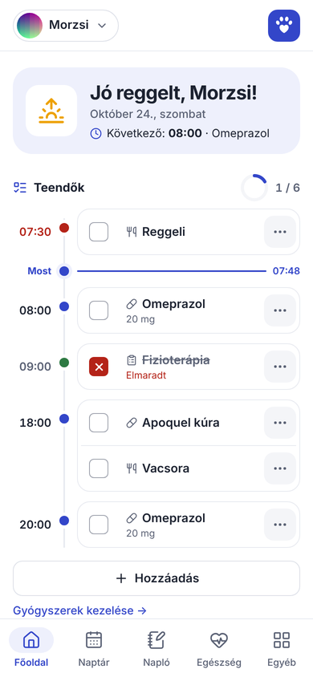
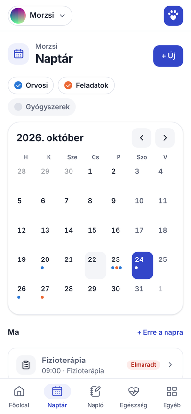
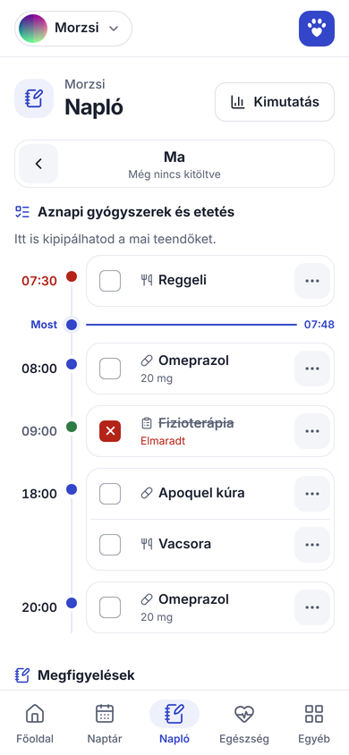
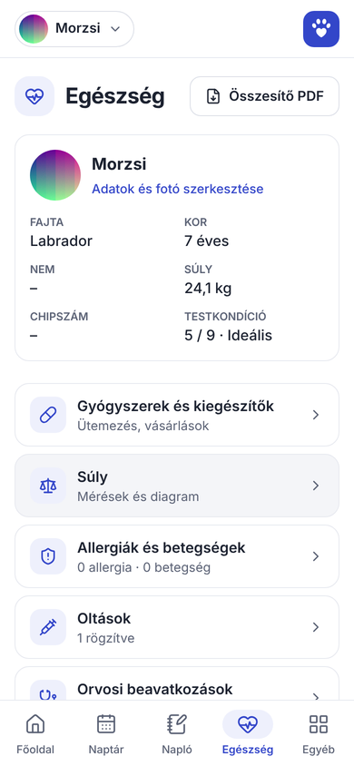
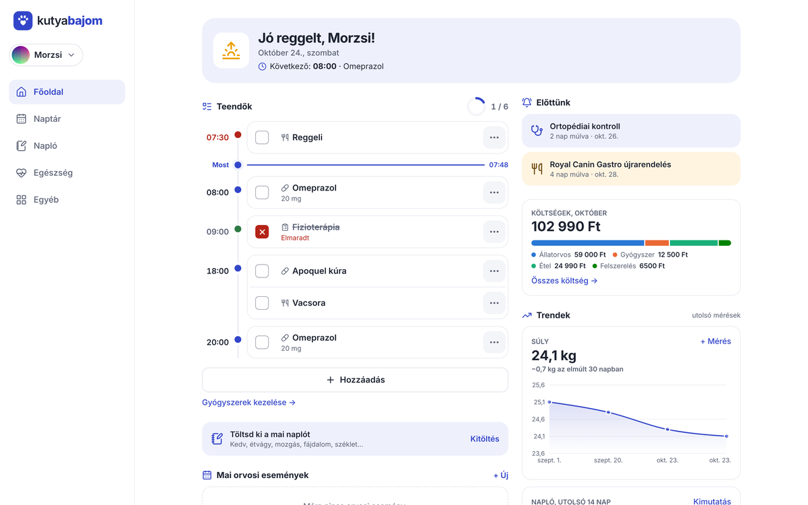

<p align="center">
  
</p>

<h1 align="center">kutyabajom</h1>

<p align="center">
  <b>Kutyád egészsége, gyógyszerei és mindennapjai egy helyen.</b><br>
  Telepíthető webalkalmazás (PWA) egészségügyi nyilvántartással, gyógyszer-emlékeztetőkkel,<br>
  napi naplóval, költségkövetéssel és push értesítésekkel – több gazdával közösen.
</p>

<p align="center">
  
  
  
  
</p>

---

## Funkciók

### 🏠 Főoldal
- Napi teendők **idővonalon**: gyógyszeradagok, reggeli és vacsora, feladatok – az azonos időpontúak egy kártyában, „Most” jelölővel
- Kipipálás egy koppintással, vagy: *más időpontban*, *nem kapta meg*, *elutasította*, visszavonás
- Haladásgyűrű, napszakhoz illő köszöntés, a következő teendő
- Emlékeztetők: újravásárlás (7 nap), orvosi vizsgálat (5 nap), feladat (1 nap), lejáró oltás
- Havi költségek kategóriánként, súly- és naplótrendek
- „Hozzáadás” menü: saját teendő, súly, napló, esemény, kiadás, dokumentum, gyógyszer

### 💊 Gyógyszerek és kiegészítők
- Egyszeri, ismétlődő (N naponta) vagy kúra jellegű ütemezés, naponta több időponttal
- Vásárlások árral, újravásárlási emlékeztető, gyógyszerlista PDF-ben

### 📅 Naptár
- Orvosi események (vizsgálat, oltás, vérvétel, kontroll) és saját típusú feladatok
- Ismétlődés (naponta, hetente, havonta, évente), rétegek: orvosi / feladatok / gyógyszerek
- „Megtörtént?” visszajelzés: oltóanyag, eredmény, lelet és költség rögzítése

### ❤️ Egészség
- Adatlap fotóval, súly és testkondíció (BCS), allergiák, betegségek
- Oltások érvényességi sávval, orvosi beavatkozások idővonalon, orvosok
- Dokumentumok (kép/PDF, automatikus képtömörítés), laborértékek referenciatartománnyal
- Egészségügyi összesítő PDF az állatorvosnak

### 📓 Napló
- Kedv, étvágy, mozgás, fájdalom, folyadék 0–10 skálán; széklet, megfigyelések, leírás
- Aznapi gyógyszerek és etetés utólagos rögzítése
- Kimutatás tetszőleges időszakra, PDF export

### 🍖 Étkezés és 💰 költségek
- Tápok és jutalomfalatok napi adaggal, újrarendeléssel; nem bevált tápok okkal
- Minden kiadás egy helyen, fánkdiagram kategóriánként, tetszőleges időszakra

### 🔔 Értesítések és közös használat
- Push értesítések (gyógyszer, emlékeztetők, „Megtörtént?”, szülinap) – iPhone-on is
- Több kutya, közös gazdik, meghívókódos regisztráció
- Admin felület: meghívók, tárhely, felhasználók felfüggesztése és törlése
- Adatmentés ZIP-ben, világos/sötét mód, tíz választható szín

<p align="center">
  
</p>

## Technológia

| Réteg | Eszköz |
|---|---|
| App | [Next.js](https://nextjs.org) 16 (App Router, Server Actions), React 19, TypeScript |
| Megjelenés | Tailwind CSS 4, lucide ikonok, Recharts diagramok, Inter betűtípus |
| Backend | [Supabase](https://supabase.com): Postgres sorszintű biztonsággal (RLS), Auth, Storage, Edge Functions, pg_cron |
| PDF | `@react-pdf/renderer` |
| Értesítések | Web Push (VAPID), service worker, percenkénti időzítő |
| Hosting | [Vercel](https://vercel.com) |

## Felépítés

```
src/
  app/
    (auth)/          belépés, regisztráció, jelszó-visszaállítás
    (app)/           a bejelentkezés utáni oldalak (főoldal, naptár, napló, egészség, ...)
    export/          PDF exportok és adatmentés (route handlerek)
  components/        közös felületi elemek
  lib/               adatlekérés, formázás, segédfüggvények
  proxy.ts           munkamenet-frissítés, belépés nélküli átirányítás
supabase/
  migrations/        az adatbázis teljes szerkezete, sorszámozott SQL fájlokban
  functions/         Edge Functionök (értesítésküldés, felhasználó törlése)
  email-templates/   magyar e-mail sablonok
public/sw.js         service worker a push értesítésekhez
```

Minden kutyához tartozó adatot sorszintű biztonság véd: csak a kutya gazdái (`pet_members`)
férnek hozzá – ezt az adatbázis ellenőrzi, nem csak a felület.

## Fejlesztés

```bash
cp .env.example .env.local   # SUPABASE_URL és SUPABASE_PUBLISHABLE_KEY
npm install
npm run dev                  # http://localhost:3000
```

Adatbázis-változás: új, sorszámozott fájl a `supabase/migrations` mappában, majd

```bash
npm run db:migrate   # alkalmazza a még le nem futott migrációkat (SUPABASE_ACCESS_TOKEN, SUPABASE_PROJECT_REF)
npm run db:types     # frissíti a src/lib/database.types.ts típusokat
```

Ellenőrzés: `npx tsc --noEmit`, `npm run lint`, `npm run build`.

## Üzemeltetés

- **Élesítés:** a `main` ágra feltöltött kódot a Vercel automatikusan kiteszi.
- **Titkos értékek** (nem a repóban): Vercel környezeti változók, Supabase Edge Function
  secretek (`VAPID_PUBLIC_KEY`, `VAPID_PRIVATE_KEY`, `CRON_SECRET`), Supabase Vault
  (`project_url`, `cron_secret`).
- **E-mail:** egyedi SMTP (Brevo); a sablonok a `supabase/email-templates` mappában.
- **Időzítők:** percenként az értesítésküldés, naponta az időzítő naplójának takarítása.
- **Mentés:** Egyéb → Adatmentés (ZIP, kérésre a fájlokkal együtt).

## Licenc

Magánprojekt, minden jog fenntartva. Az Inter betűtípus az SIL Open Font License 1.1
alatt használható (`src/fonts`).
